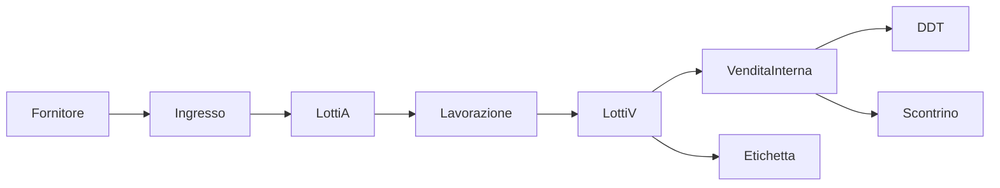

# Piano prodotto: rendere GestLab vendibile

Documento di prodotto (non di implementazione codice). Descrive i miglioramenti
necessari perché GestLab sia vendibile come SaaS a macellerie che sezionano e
producono preparati da cuocere.

**Data aggiornamento:** 2026-11-07

**Canale:** SaaS multi-tenant (`saas/` + console `web/`)  
**Perimetro v1 concordato:** laboratorio (ingresso, lotti, lavorazioni,
etichette, scadenze, ricette) + vendite interne (scarico lotti, DDT, scontrino
**non fiscale**, listini).

Documenti correlati:

- [TRACCIABILITA_ARTICOLI.md](TRACCIABILITA_ARTICOLI.md)
- [PIANO_ANAGRAFICA_CLIENTI_FORNITORI.md](PIANO_ANAGRAFICA_CLIENTI_FORNITORI.md)
- [SAAS_MIGRATION_PLAN.md](SAAS_MIGRATION_PLAN.md)
- [SAAS_PRINTING_BARCODE_PLAN.md](SAAS_PRINTING_BARCODE_PLAN.md)
- [ISTRUZIONI_USO.md](ISTRUZIONI_USO.md)
- [PUBBLICAZIONE_AWS_TEST.md](PUBBLICAZIONE_AWS_TEST.md)
- [CREAZIONE_NUOVO_TENANT.md](CREAZIONE_NUOVO_TENANT.md)

---

## 1. Posizionamento

GestLab è un **mini gestionale di laboratorio** per OSA (operatori del settore
alimentare) del canale macelleria / gastronomia da cuocere. Il valore da
vendere non è un ERP né una cassa fiscale, ma:

1. **Rintracciabilità a lotti** da fornitore a prodotto finito (Reg. CE 178/2002).
2. **Trasformazione** (sezionamento, macinatura, assemblaggio preparati) con
   rese e scarti.
3. **Etichettatura** dei preparati (ingredienti, allergeni, lotto, scadenza)
   in linea con lo spirito del Reg. UE 1169/2011, senza certificare la
   conformità legale al posto del cliente.
4. **Vendita interna** verso clienti anagrafici (banco, ristorazione, HORECA)
   con scarico magazzino, DDT e ricevuta **non fiscale**.

Flusso obiettivo:

Oggi questo flusso è **incompleto**: ingresso tracciato e lavorazioni esistono;
schema e API supportano alcuni metadati dei lotti, ma la UI d'ingresso non li
raccoglie ancora. Vendita, documenti persistenti, ricette e hardening SaaS
restano da completare.

---

## 2. Fuori perimetro v1

Queste voci **non** fanno parte del primo prodotto vendibile. Vanno escluse
dal contratto e dal marketing, per evitare aspettative fiscali o HACCP
complete.

| Area | Motivo |
|---|---|
| Registratore telematico / corrispettivi | Integrazione hardware certificato, normativa AdE. Lo scontrino v1 è **non fiscale**. |
| Fatturazione elettronica / SDI / FatturaPA | Progetto dedicato. I campi `pec` e `codice_destinatario` su `soggetti` restano per una fase successiva. |
| POS / pagamenti elettronici in cassa | Fuori dal nucleo laboratorio + documento di cessione. |
| Uso offline della console | Escluso dal perimetro SaaS attuale (`ISTRUZIONI_USO.md`). |
| Client desktop Kivy/Tkinter | Rimosso; unica UI supportata è la console web. |
| Software HACCP completo | CCP, audit sanitari, manuale HACCP firmato: eventuale “HACCP lite” solo se richiesto dal pilota. |
| Self-service billing (Stripe) | Dopo 1–2 clienti pilota a contratto manuale. |
| 2FA | Dopo il pilota, non bloccante per il primo contratto. |

Cosa **non** promettere in brochure: “sostituisce la cassa fiscale”, “etichetta
certificata 1169”, “HACCP conforme ASL”, “fattura elettronica inclusa”.

---

## 3. Stato attuale vs obiettivo

Legenda: **C** = coperto, **P** = parziale, **A** = assente.

### 3.1 Funzioni di dominio

| Funzione | Stato | Dove / nota |
|---|---|---|
| Login JWT, ruoli admin/operatore, tenant dal token | P | [`saas/auth.py`](../saas/auth.py): bcrypt + access/refresh; in produzione rifiuta il secret di default. Mancano reset password, rate limit e revoca. |
| Tenant e utenti | P | [`saas/crea_tenant.py`](../saas/crea_tenant.py), `POST /api/v1/tenant`, `POST /api/v1/utenti`. Onboarding manuale. |
| Anagrafica clienti/fornitori (`soggetti`) | C | CRUD web e API. Soft-delete. Campi utili a FE futuri già presenti. |
| Dipendenti, reparti, merceologie | P | CRUD presente; schema legacy (`utf8mb3`, `tenant_id` nullable). |
| Catalogo articoli | C | [`articoli`](../saas/init_database.sql) è la fonte unica per anagrafica, EAN e prezzo; `articoli_bilancia` contiene solo la configurazione Bizerba collegata all'articolo. Resta da realizzare l'export Bizerba combinato. |
| Ingresso merce tracciato → lotti `A` | C | `POST /api/v1/tracciabilita/ingressi`, UI wizard in [`web/js/features/ingresso-merce.js`](../web/js/features/ingresso-merce.js). |
| Ingresso merce legacy | P | `POST /api/v1/ingresso-merce` risponde `410 Gone` ed è escluso da OpenAPI. Il bootstrap non crea più `ingresso_merce` e archivia la tabella esistente come `ingresso_merce_legacy_archive`; resta da verificare l'esito sui database in uso. |
| Lavorazioni multi input/output/scarti → lotti `V` | C | `POST /api/v1/tracciabilita/lavorazioni`, UI [`web/js/features/tracciabilita.js`](../web/js/features/tracciabilita.js). |
| Dettaglio genealogia lotto (API) | P | `GET /api/v1/tracciabilita/lotti/{id}`. UI albero e PDF NAS/ASL assenti. |
| Scadenza, origine, lotto fornitore e temperatura d'ingresso | P | Campi presenti in `lotti`, schema API, repository e migrazione `20261107_lotti_metadata.sql`; il wizard web non li raccoglie ancora e i lotti `V` non li ereditano. Il TMC non ha un campo dedicato. |
| Ricette / distinta base preparati | A | Ogni lavorazione è ad-hoc. |
| Allergeni e ingredienti strutturati | A | Etichetta: testo libero in [`web/js/features/printing.js`](../web/js/features/printing.js). |
| Inventario / rettifica giacenza | P | `movimenti_lotto.tipo = RETTIFICA` nello schema; nessuna UI né API dedicata. |
| Vendita / scarico lotti | A | [`core/services/vendite.py`](../core/services/vendite.py) può chiudere un lotto azzerandone la giacenza, ma non esiste ancora un flusso di vendita con scarico parziale e movimento `VENDITA`. |
| DDT persistente legato a lotti e cliente | A | `POST /api/v1/ddt` genera PDF da payload libero; campo `fornitore` fuorviante in vendita. |
| Scontrino non fiscale da vendita | A | `POST /api/v1/scontrino` genera ESC/POS da payload libero, senza magazzino. |
| Menu / listino banco | P | `GET /api/v1/menu` legge gli articoli attivi; la configurazione Bizerba non è il catalogo. |
| Stampa locale (agent) | P | Coda `print_jobs` + [`saas/print_agent.py`](../saas/print_agent.py). Collaudo periferiche e installer Windows da fare. L'endpoint etichetta può derivare scadenza e origine da `lotto_id`, ma la maschera resta in gran parte manuale. |
| Lookup EAN | P | API + campo dashboard; EAN e prezzo sono dati dell'articolo. |
| Dashboard operativa | P | Conteggio anagrafiche/lotti/job in [`web/js/features/dashboard.js`](../web/js/features/dashboard.js). Niente scadenze, giacenze critiche, vendite. |
| HACCP / temperature | A | — |
| Fatturazione elettronica | A | Fuori v1. |
| Billing abbonamento SaaS | A | Fuori v1 (contratto manuale). |

### 3.2 Qualità e operatività

| Tema | Stato | Nota |
|---|---|---|
| Isolamento tenant | P | JWT porta `tenant_id`; tabelle legacy con `tenant_id` nullable e FK incomplete. |
| Pool DB / TLS | A | [`core/db.py`](../core/db.py) apre una connessione per richiesta. |
| Migrazioni | P | [`saas/init_database.sql`](../saas/init_database.sql) per installazioni nuove; [`saas/migrations/`](../saas/migrations/) da applicare a mano sui DB esistenti. Bootstrap non esegue tutte le migrazioni. |
| Test | P | Unit: soggetti, tracciabilità, ingresso, dipendenti, bootstrap. E2E [`tests/test_saas_e2e.py`](../tests/test_saas_e2e.py) **distruttivo**. |
| Produzione | P | Guida Lightsail di test. Niente RDS+PITR, staging, Sentry, secret manager obbligatorio. |
| GDPR / legale | A | Accennato in `SAAS_MIGRATION_PLAN.md`. Nessuna informativa, DPA, export tenant. |
| Manuale utente | P | `ISTRUZIONI_USO.md` è per sviluppatori (venv, uvicorn, agent). |

---

## 4. Debito tecnico bloccante (prima delle feature)

Senza questa unificazione i dati di produzione **non sono affidabili** e le
vendite interne non possono scaricare un magazzino unico.

### 4.1 Un solo ingresso merce

Esisteva un doppio percorso:

- `POST /api/v1/ingresso-merce` → tabella legacy `ingresso_merce`.
- `POST /api/v1/tracciabilita/ingressi` → `documenti_ingresso` + lotti `A`.

**Fatto (2026-11-07):** l'endpoint legacy restituisce `410 Gone` ed è escluso
da OpenAPI; la UI usa il flusso tracciato. Il bootstrap archivia la vecchia
tabella con una rinomina atomica, preservando tutti i dati e lo schema senza
tentare associazioni automatiche.

**Da verificare sul database esistente:** dopo il bootstrap controllare che
`ingresso_merce` non esista più, confrontare il conteggio di
`ingresso_merce_legacy_archive` con il backup e conservare l'archivio finché
non sarà decisa un'eventuale riconciliazione esplicita.

**Criterio:** un ingresso dal wizard crea lotti `A` e movimenti `INGRESSO`;
nessuna riga nuova viene scritta nell'archivio legacy.

### 4.2 Un solo catalogo e configurazione bilancia separata

Oggi:

- `articoli`: nome, codice, categoria, UM, flag input, attivo — usato da
  ingresso e lavorazioni.
- La vecchia tabella `prodotti` mescolava anagrafica e campi del tracciato
  Bizerba. Inoltre alcune query cercavano `codice` e `prezzo_kg`, colonne che
  non esistono nel suo DDL.

**Fatto (2026-11-07):** `articoli` è la fonte unica per nome, codice, categoria, unità di
misura, EAN e prezzo unitario. `articoli_bilancia` conserva solo i parametri
specifici dell'esportazione Bizerba (PLU, reparto, tara, conservazione, testi e
formati) ed è collegata con `(tenant_id, articolo_id)`. Il nome e i dati
commerciali non vanno duplicati nel profilo bilancia. La generazione dei file
Bizerba richiederà un exporter che unisca articolo e profilo; non è inclusa in
questa modifica.

Non essendoci clienti da migrare, le nuove installazioni usano direttamente lo
schema aggiornato. Un database di sviluppo già creato va aggiornato o
ricreato esplicitamente; il bootstrap non elimina la vecchia tabella né i suoi
dati.

**Criterio:** vendita, etichetta e lookup EAN usano lo stesso `articolo_id`
dei lotti; menu e lookup non leggono più la vecchia tabella `prodotti`.
L'export Bizerba che combina i dati di `articoli` e `articoli_bilancia` resta
un'attività separata; sulle installazioni esistenti la vecchia tabella e i suoi
dati non vengono eliminati automaticamente.

### 4.3 Un solo modello lotti

`GET /api/v1/lotti/aperti` (legacy) e `GET /api/v1/tracciabilita/lotti` (A/V)
non devono convivere in UI.

**Stato:** ingresso e lavorazione registrano le variazioni di giacenza e i
relativi movimenti nella stessa transazione. `chiudi_lotto` può disattivare
solo un lotto con giacenza già a zero: non modifica la quantità e non
sostituisce un flusso di vendita. I test verificano il rollback se non è
possibile registrare il movimento.

**Criterio:** [`core/services/vendite.py`](../core/services/vendite.py) non
solleva `NotImplementedError`; le giacenze aperte provengono da `lotti`.

### 4.4 Schema e migrazioni

Problemi residui in [`saas/init_database.sql`](../saas/init_database.sql):

- tabelle business legacy in `utf8mb3`;
- quantità e date spesso `varchar`;
- `tenant_id` nullable su `reparti`, `dipendenti`, `fornitori`, `merceologie`,
  `prodotti`, `progressivi`;
- FK incomplete tra merceologie/reparti/dipendenti.

**Azione:**

- PK su ogni tabella; quantità `DECIMAL(12,3)`; `tenant_id NOT NULL` + FK
  verso `tenant`;
- charset `utf8mb4`;
- processo unico: nuove installazioni da schema consolidato; esistenti solo
  via script in `saas/migrations/` (o Alembic). Documentare l’ordine. Il
  bootstrap non deve “dimenticare” migrazioni come quella soggetti.

**Criterio:** un DB nuovo e uno migrato espongono le stesse colonne usate dal
codice; nessun insert su tabelle senza PK.

### 4.5 Database e segreti

- TLS verso MySQL/RDS in produzione.
- Pool di connessioni (oggi una connect per request in `core/db.py`).
- Credenziali solo da env / Secret Manager; rimuovere il fallback
  `config.ini` in un intervento dedicato (già previsto in
  `SAAS_MIGRATION_PLAN.md`).

**Criterio:** health check verde; sotto carico le connessioni sono riusate;
deploy con credenziali protette e secret di default rifiutato se
`GESTLAB_ENV=production` (quest'ultimo controllo è già implementato).

> Aggiornamento implementativo 2026-11-07:
> - `saas/auth.py` blocca l’avvio con `JWT_SECRET` di default in `GESTLAB_ENV=production`.
> - `saas/main.py` depreca l’endpoint legacy `/api/v1/ingresso-merce` con `410 Gone` e lo nasconde dal schema OpenAPI.
> - `core/services/vendite.py` non lancia più `NotImplementedError`; la funzione di chiusura azzera giacenza e stato attivo, ma non realizza ancora una vendita né un decremento parziale.
> - `saas/init_database.sql` include il valore `VENDITA` nel `CHECK` di `movimenti_lotto.tipo` e la migrazione `saas/migrations/20261107_movimenti_lotto_vendita.sql` allinea i DB esistenti.
> - `saas/init_database.sql`, `saas/schemas.py` e il repository tracciabilità supportano scadenza, lotto fornitore, origine e temperatura d'ingresso; la migrazione `saas/migrations/20261107_lotti_metadata.sql` aggiorna i DB esistenti.

---

## 5. Fase A — Laboratorio vendibile

Obiettivo: il macellaio dimostra rintracciabilità e stampa etichette credibili
sui preparati, senza Excel di appoggio.

### 5.1 Dati di lotto per la carne e i preparati

I campi `data_scadenza`, `lotto_fornitore`, `origine` e
`temperatura_ingresso` sono già presenti nello schema e accettati dall'API di
ingresso. Il wizard web non li raccoglie ancora; inoltre TMC non è distinto
dalla scadenza e i lotti `V` non ereditano i metadati dagli input. Per
completare la gestione:

- inserire lotto fornitore e riferimento del documento (il DDT d'ingresso è
  già registrato a livello documento);
- paese di origine / allevamento (e, se disponibile, macellazione e
  sezionamento — approvazione veterinaria);
- data di scadenza o TMC, chiarendo quale campo e regola applicare;
- temperatura all’ingresso (opzionale);
- note (es. “bio”, “razza”), oggi non previste nei metadati del lotto.

Sui lotti `V`: scadenza calcolata da ricetta o inserita (es. +N giorni da
produzione); origine aggregata dagli input (testo etichetta). Definire se e
come distinguere scadenza e TMC per gli articoli interessati.

**Criterio:** il wizard consente di registrare lotto fornitore, origine,
scadenza e, se necessario, temperatura; in dettaglio si vedono questi dati
insieme a fornitore e DDT. I `V` di una lavorazione ereditano o dichiarano
origine e scadenza.

### 5.2 FEFO e alert

- Selezione lotto in lavorazione e in vendita: default al lotto che scade
  prima tra quelli con giacenza.
- Dashboard: lotti in scadenza (es. 48h / 7 giorni), giacenza a zero, job di
  stampa in errore.

**Criterio:** la dashboard non è solo un conteggio anagrafiche; un lotto in
scadenza è visibile senza aprire Tracciabilità.

### 5.3 Genealogia e export controllo

L’API di dettaglio esiste. Serve UI:

- albero **indietro**: lotto `V` → lavorazione → lotti input → documento
  ingresso → fornitore;
- albero **avanti**: lotto `A` → lavorazioni → lotti `V` → (fase B) vendite;
- export PDF “scheda lotto” per NAS/ASL (non un certificato legale).

**Criterio:** da un lotto di salsicce si arriva al DDT fornitore in meno di un
minuto, da UI e da PDF.

### 5.4 Ricette / distinta base

Per preparati da cuocere (spiedini, hamburger, involtini, salsiccia, cotolette
impanate, ecc.):

- anagrafica ricetta per tenant: articolo output, rese attese, scarto atteso;
- righe: articolo input, quantità per kg (o %) di output, obbligatorietà;
- allergeni e lista ingredienti **della ricetta** (base etichetta);
- giorni di vita del prodotto;
- istruzioni (temperatura cottura consigliata, conservazione).

La registrazione lavorazione può partire dalla ricetta: precompila input
(lotti FEFO) e output; l’operatore conferma pesi reali.

**Criterio:** “Salsicce fresche” si produce da ricetta in un form guidato;
l’etichetta usa gli ingredienti della ricetta, non un campo libero vuoto.

### 5.5 Etichette da dati, non da form vuoto

Oggi `POST /api/v1/etichetta` e la maschera Stampa chiedono ancora PLU,
prodotto, prezzo, ingredienti e codice; se viene fornito `lotto_id`, l'API
precompila scadenza e origine dai dati del lotto.

Obiettivo:

- stampa da `lotto_id` (o articolo + lotto);
- testi: denominazione, ingredienti, allergeni evidenziati, lotto interno,
  scadenza, conservazione, sede OSA del tenant, peso/prezzo se noti;
- coda `print_jobs` + Local Print Agent (DYMO), come da
  `SAAS_PRINTING_BARCODE_PLAN.md`.

**Criterio:** etichetta di un preparato contiene lotto, scadenza,
ingredienti/allergeni derivati, senza ricopiarli a mano (override opzionale
solo per admin).

### 5.6 Inventario

- UI rettifica: lotto, delta, motivo (inventario, calo, reso, errore).
- Movimento `RETTIFICA` già previsto dallo `CHECK` su `movimenti_lotto`.
- Conteggio fisico per articolo (somma lotti) vs teorico.

**Criterio:** una rettifica di −0,250 kg su un lotto `V` aggiorna
`quantita_disponibile` e lascia traccia; non si “corregge” editando il lotto.

### 5.7 HACCP lite (opzionale, dopo il pilota di dominio)

Solo se il primo cliente lo chiede esplicitamente:

- temperatura all’ingresso e in cella (registro giornaliero semplice);
- niente manuale HACCP, niente firme digitali ASL.

Minimo vendibile di Fase A **senza** HACCP lite: scadenze + genealogia +
etichette da ricetta.

---

## 6. Fase B — Vendite interne

Obiettivo: scaricare magazzino e documentare la cessione **senza** obbligo
fiscale RT.

### 6.1 Documento di vendita

Nuovo aggregato (nome da definire in implementazione, es. `documenti_vendita`
+ `righe_vendita`):

- tenant, data, numero da `progressivi.prog_ven` (blocco come in ingresso);
- cliente opzionale (`soggetti` con ruolo cliente) oppure “banco”;
- tipo documento: `DDT` | `RICEVUTA` (entrambi non fiscali);
- righe: `lotto_id`, `articolo_id`, quantità, UM, prezzo unitario, IVA
  informativa;
- transazione unica: decremento `quantita_disponibile`, movimento
  `VENDITA` (già ammesso dallo schema aggiornato e dalla relativa migrazione),
  chiusura lotto se giacenza a zero.

Estendere [`core/services/vendite.py`](../core/services/vendite.py) e repository
tracciabilità; non chiudere lotti sul modello legacy.

**Criterio:** vendita di 1,5 kg da un lotto `V` riduce la giacenza di 1,5;
secondo tentativo oltre disponibilità → 409; genealogia “avanti” mostra il
documento.

### 6.2 UI Banco / Vendita (tablet)

- ricerca articolo;
- lotto proposto FEFO, cambiabile;
- quantità/peso;
- totale e stampa;
- pochi tap; niente JSON.

**Criterio:** un operatore completa una vendita a cliente anagrafico e stampa
DDT senza aprire Configurazioni.

### 6.3 Listini

Prezzo unitario commerciale sull’articolo (al kg e/o al pezzo), eventuale
listino HORECA vs banco in v1.1 se serve. IVA in stampa è **informativa**, non
certificata. `articoli_bilancia.prezzo1` è un campo del tracciato Bizerba e non
la fonte canonica del prezzo commerciale.

**Criterio:** il prezzo in vendita e in etichetta coincide con l’anagrafica
articolo.

### 6.4 DDT persistente

Oggi [`POST /api/v1/ddt`](../saas/main.py) non salva nulla e usa `fornitore`
come intestazione.

Obiettivo:

- PDF generato dal documento vendita salvato;
- destinatario = soggetto cliente (ragione sociale, indirizzo);
- mittente = dati OSA del tenant;
- righe con articolo, lotto, qta;
- numerazione progressiva per tenant;
- ristampa dalla coda / dallo storico.

**Criterio:** due click sullo stesso DDT producono lo stesso numero e le
stesse righe; il PDF non è un blob orfano.

### 6.5 Scontrino / ricevuta non fiscale

Stesso documento vendita → ESC/POS via print agent.

Obbligatorio in stampa (testata o pie’): **“Documento non fiscale — non
sostituisce lo scontrino del registratore telematico”**.

**Criterio:** la ricevuta elenca righe e totale; un commercialista/cliente
non può confonderla con un RT.

### 6.6 Menu

Da sola lettura `GET /api/v1/menu` a listino operativo degli articoli
vendibili (preparati del giorno = subset articoli attivi con giacenza). La
“composizione menu” legacy (primi/secondi/contorni da ristorazione) non è il
cuore macelleria; si riusa solo se i preparati si raggruppano per merceologia.

**Criterio:** il banco mostra solo articoli attivi con almeno un lotto
disponibile (filtro disattivabile).

---

## 7. Fase C — SaaS operabile

Senza questa fase si può fare un pilota assistito, non un abbonamento
ripetibile.

### 7.1 Autenticazione e ruoli

- reset password (email);
- policy password;
- rate limit su `/auth/login`;
- rotazione refresh token e logout/revoca;
- rifiuto JWT secret di default in produzione;
- ruoli restano `admin` e `operatore` in v1; audit log almeno su delete e
  rettifiche (oggi il commento in `DELETE /api/v1/dipendenti` ammette l’assenza).

2FA: post-pilota.

**Criterio:** password dimenticata senza accesso al DB; 10 login falliti non
restano illimitati; un refresh rubato si ruota.

### 7.2 Isolamento tenant

- `tenant_id` sempre dal JWT, mai dal body;
- `tenant_id NOT NULL` ovunque;
- test IDOR: utente tenant A su ID di tenant B → 404 su lotti, soggetti,
  vendite, print job, dispositivi.

**Criterio:** suite automatica che fallisce la build se un GET cross-tenant
restituisce 200 con dati.

### 7.3 Onboarding

Oggi: script [`saas/crea_tenant.py`](../saas/crea_tenant.py) e bootstrap
(`saas/bootstrap.py`).

Obiettivo operativo (anche solo interno, non self-service pubblico):

- wizard/CLI: tenant, dati OSA (ragione sociale, sede, laboratorio), primo
  admin, catalogo vuoto o template macelleria;
- documento interno già in `CREAZIONE_NUOVO_TENANT.md` allineato al wizard.

Self-service pubblico: dopo billing.

**Criterio:** un nuovo laboratorio è operativo (login + ingresso) in meno di
30 minuti di lavoro interno, senza SQL a mano.

### 7.4 Produzione

Oltre Lightsail di test ([PUBBLICAZIONE_AWS_TEST.md](PUBBLICAZIONE_AWS_TEST.md)):

- HTTPS (dominio + Certbot o load balancer);
- DB gestito con backup automatici e point-in-time recovery;
- secret manager;
- ambiente staging;
- `/health` già presente: usarlo in monitoring;
- error tracking (es. Sentry) e log già parziali (`logs/gestlab-saas.log` per
  ingressi tracciati);
- Local Print Agent come servizio Windows documentato (installazione, token,
  restart).

**Criterio:** restore di backup di prova riuscito; agent riparte al reboot del
PC di banco; staging non è il DB di produzione.

### 7.5 Billing

Contratto manuale per i primi 1–2 pilota (bonifico, piano `tenant.piano`
già nello schema come stringa). Stripe/portale self-service: fase successiva
(`SAAS_MIGRATION_PLAN.md` Fase 7).

### 7.6 GDPR e contratto

Dati personali: dipendenti, clienti, utenti, email.

- informativa privacy e base giuridica;
- DPA con il cliente OSA e con il cloud provider;
- export dati del tenant (portabilità);
- cancellazione conforme: anagrafiche già in soft-delete; **vietare** delete
  hard di lotti e documenti (vincoli RESTRICT già sullo schema nuovo);
- nel contratto SaaS: esclusione esplicita di validità fiscale RT/FE e di
  certificazione etichette/HACCP.

**Criterio:** checklist legale firmata prima del primo canone; export JSON/CSV
del tenant eseguibile da admin.

### 7.7 UX e collaudo

- lookup EAN: nome articolo, non `JSON.stringify`;
- errori API in italiano (già in parte);
- flussi banco/laboratorio su tablet (viewport, tastiera virtuale, scanner HID);
- niente schermate da sviluppatore in produzione (`/docs` chiuso o protetto).

**Criterio:** collaudo su un tablet reale: ingresso, lavorazione da ricetta,
etichetta, vendita DDT.

### 7.8 Documentazione e test

- manuale utente (ingresso → lavorazione → etichetta → vendita), distinto da
  `ISTRUZIONI_USO.md`;
- video o sequenza screenshot per il pilota;
- test vendita, scadenze, isolamento tenant;
- e2e **non** eseguito su database con dati da conservare; oggi
  `test_saas_e2e.py` ricrea tabelle.

**Criterio:** un nuovo operatore completa il flusso pilota col solo manuale
utente.

---

## 8. Ordine di lavoro consigliato

Lavorare in serie: ogni passo sblocca il successivo. Non aprire vendita
interna sul catalogo doppio.

| Ordine | Pacchetto | Fase |
|---|---|---|
| 1 | Consolidare schema/migrazioni e dati legacy; pool DB e TLS; catalogo unificato e ingresso legacy disabilitato (fatti: catalogo, endpoint legacy, secret production-safe, tipo movimento `VENDITA`) | Debito |
| 2 | UI metadati lotto, scadenze, origine, genealogia UI, etichette da lotto (parziale: campi schema/API e precompilazione stampa da `lotto_id`) | A |
| 3 | Ricette/preparati + lavorazione guidata + inventario rettifiche | A |
| 4 | Vendita interna, movimenti `VENDITA`, DDT e scontrino persistenti, UI banco | B |
| 5 | Hardening SaaS, backup, onboarding interno, GDPR, manuale, collaudo tablet | C |
| 6 | Pilota pagante (contratto manuale) | Go-live |
| 7 | Billing self-service, 2FA, HACCP lite, FE/RT | Fuori v1 |

---

## 9. Criteri di “prodotto vendibile”

Il prodotto è vendibile a un laboratorio pilota quando **tutti** i punti
seguono sono veri:

1. Un mese di ingressi e lavorazioni è registrato in GestLab senza foglio Excel
   di appoggio.
2. Da un lotto di preparato (es. salsicce) si risale al DDT fornitore in meno
   di un minuto (UI + PDF scheda lotto).
3. L’etichetta del preparato riporta ingredienti, allergeni, lotto interno e
   scadenza, stampata tramite Local Print Agent.
4. Una vendita a cliente anagrafico con DDT scarica i lotti; le giacenze restano
   coerenti con `movimenti_lotto`.
5. Lo scontrino/ricevuta reca la dicitura di documento **non fiscale**.
6. Il tenant B non legge dati del tenant A (test automatico).
7. Backup ripristinabile; JWT e password di produzione non sono i default di
   sviluppo.
8. Il contratto SaaS esclude RT, FatturaPA e certificazione legale etichette/HACCP.

Finché manca uno di questi punti, il rilascio resta **pilota tecnico**, non
prodotto in vendita.

---

## 10. Riferimenti codice (baseline 2026-11)

| Area | Path |
|---|---|
| Schema unificato | [`saas/init_database.sql`](../saas/init_database.sql) |
| API FastAPI | [`saas/main.py`](../saas/main.py) |
| Auth JWT | [`saas/auth.py`](../saas/auth.py) |
| Lotti e lavorazioni | [`saas/repositories/tracciabilita_repo.py`](../saas/repositories/tracciabilita_repo.py) |
| Vendite (solo helper di chiusura lotto; flusso vendita non implementato) | [`core/services/vendite.py`](../core/services/vendite.py) |
| Stampa PDF/ESC/POS | [`core/services/printing.py`](../core/services/printing.py) |
| Print agent | [`saas/print_agent.py`](../saas/print_agent.py) |
| DB | [`core/db.py`](../core/db.py) |
| Console | [`web/index.html`](../web/index.html), [`web/js/`](../web/js/) |
| Test tracciabilità | [`tests/test_tracciabilita.py`](../tests/test_tracciabilita.py) |
