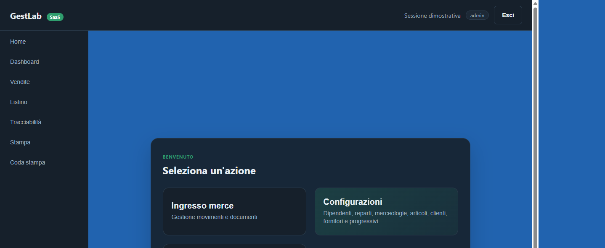
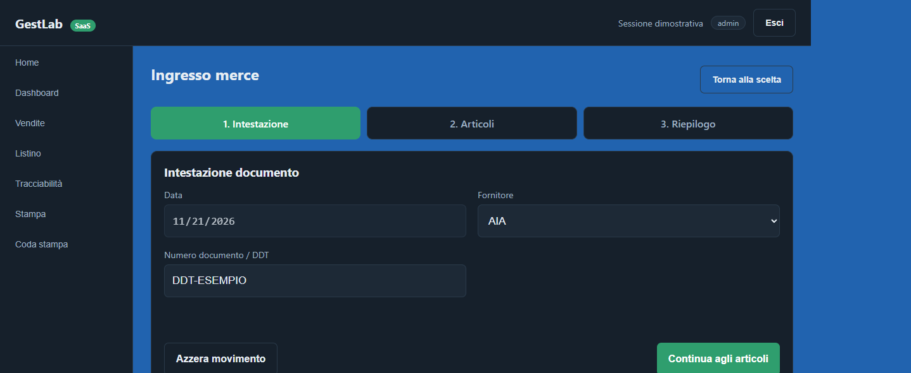
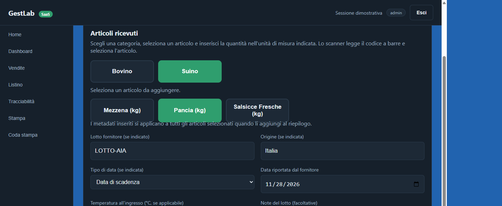
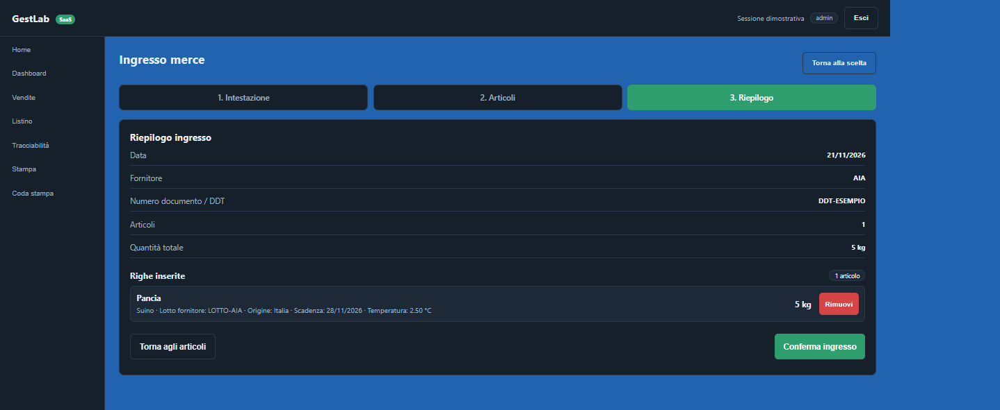
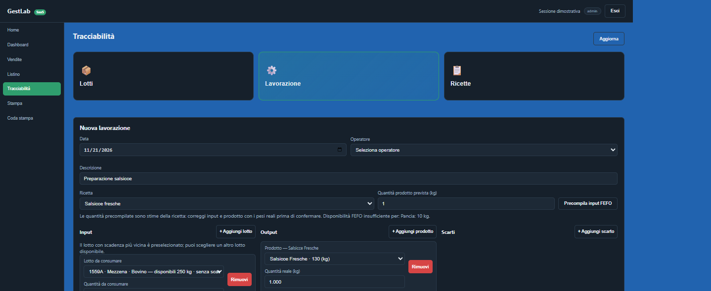
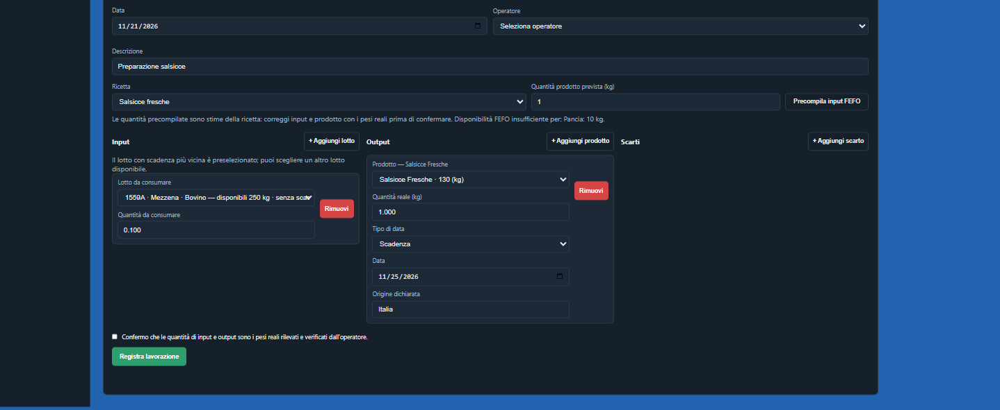
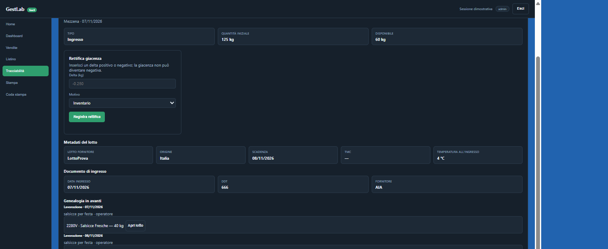
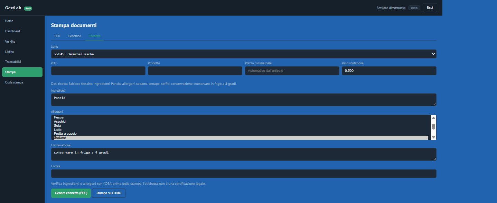
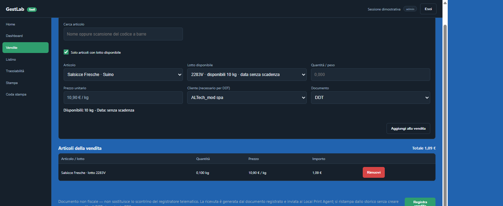
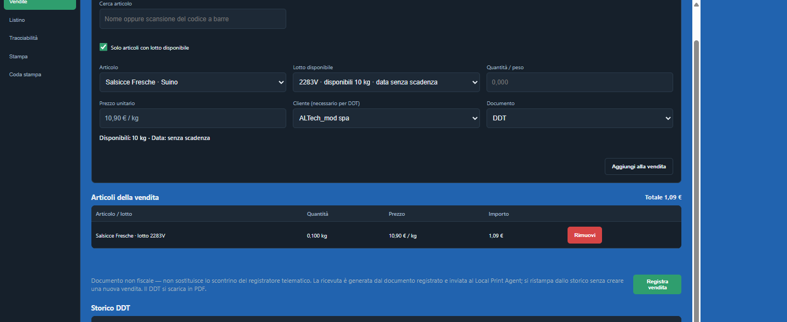

# Sequenza per il pilota

Schermate della console, nello stesso ordine del
[manuale utente](../MANUALE_UTENTE.md): accesso, ingresso, lavorazione,
etichetta e vendita. Non è un video. Le immagini sono state prese il
21 novembre 2026 sul laboratorio di prova GestLabProva.

Nessuna di queste schermate ha registrato un movimento nuovo. L’ingresso di
esempio è stato azzerato prima della conferma. La lavorazione e la vendita
sono state compilate e non registrate. La genealogia mostra lotti già
presenti. Nel dettaglio del lotto di origine il nome dell’operatore storico
compare come «operatore».

## 1. Accesso

Email, password e **Accedi**. **Password dimenticata** sta sotto il pulsante.

## 2. Home

Dopo l’accesso si sceglie **Ingresso merce**, **Configurazioni** o
**Tracciabilità**. Il menu a sinistra apre anche Vendite, Listino e Stampa.

## 3. Ingresso — intestazione

Data di oggi, fornitore abilitato all’ingresso e numero del DDT. Qui il
fornitore è AIA e il documento è `DDT-ESEMPIO`.

## 4. Ingresso — articoli

Categoria **Suino**, articolo **Pancia**, lotto fornitore, origine e data di
scadenza. Quantità e temperatura si compilano nella stessa schermata, subito
sotto, prima di **Aggiungi al riepilogo**.

## 5. Ingresso — riepilogo

Il riepilogo ripete fornitore, DDT e la riga con lotto, origine, scadenza e
temperatura. **Conferma ingresso** crea il lotto. In questa sequenza non è
stato premuto.

## 6. Lavorazione da ricetta

Ricetta **Salsicce fresche** e quantità prevista. **Precompila input FEFO**
segnala che la Pancia disponibile non basta: il messaggio va letto prima di
registrare. Il lotto proposto è il primo in ordine FEFO e si può cambiare.
La quantità resta un peso da verificare.

## 7. Data e origine del preparato

Sul prodotto si dichiarano scadenza (o TMC) e origine. Non arrivano da soli
dai lotti in ingresso. La casella dei pesi reali va spuntata solo dopo la
verifica. **Registra lavorazione** non è stato premuto.

## 8. Dal preparato al DDT

Dal lotto prodotto si apre il lotto di ingresso. Qui il lotto 1565A (Mezzena)
mostra il DDT 666, il fornitore AIA, l’origine, la scadenza e la temperatura.
**Scarica scheda PDF** produce il riepilogo. Non è una certificazione.

## 9. Etichetta

In **Stampa**, scheda **Etichetta**, il lotto 2284V porta la ricetta
Salsicce fresche: ingrediente Pancia, allergeni e conservazione. Il prezzo
commerciale è quello dell’articolo. L’avviso in basso ricorda che l’etichetta
non è una certificazione legale. **Genera etichetta (PDF)** scarica il
foglio; **Stampa su DYMO** lo mette in coda.

## 10. Vendita

Articolo con lotto disponibile, prezzo dell’articolo, cliente e documento
**DDT**. La riga in basso è solo nel carrello.

Prima di **Registra vendita** la schermata riporta che il documento non è
fiscale e non sostituisce lo scontrino del registratore telematico. In questa
sequenza la vendita non è stata registrata: giacenze e documenti restano
invariati. Dopo una registrazione vera, il DDT si scarica in PDF e la
ricevuta va alla stampante del banco; la ristampa usa lo storico e non crea
un altro documento.
